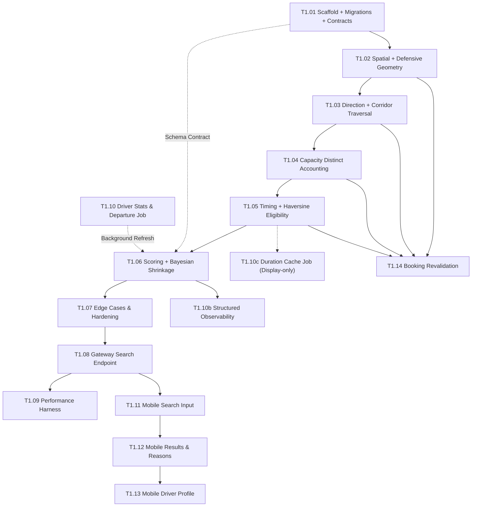

# Phase 1A — Route Matching and Discovery (Final Revision)

> **Implementation progress:** [Amendment report](PHASE1A-amendment-progress.md) records code changes and local verification. Use it alongside the amendment; historical checked tasks below are not evidence for the revised behavior.

> **Current authority (2026-10-21):** [Service-area amendment](PHASE1A-service-area-amendment.md) and [ADR-011](../docs/decisions/ADR-011-service-area-discovery-and-driver-acceptance.md).
> The amendment is the active plan and must be completed before continuing T1.12. It defines discovery, ranking, requestability, run feasibility, migration, and replacement checkpoints.
>
> **Historical baseline below:** All architecture decisions, formulas, task criteria, dependency diagrams, estimates, and “final implementation gate” statements below describe the previous corridor model. They are retained to preserve implementation history, including existing checked tasks; they are not current acceptance criteria. In particular, mandatory route geometry, hard corridor/direction filters, blanket overlapping-window rejection, and Haversine-only acceptance are superseded. Use the amendment's explicit retained rules and task mapping.
>
> **Task IDs:** The old Phase 1A T1.14 is superseded by A1.06/A1.10 and Phase 1B T1.16. T1.14 in the current master task list means pending request creation only.

## Historical corridor baseline (superseded)

> **Estimated duration:** 4–6 weeks (single developer), 3–4 weeks (two developers in parallel)
>
> Highest-risk phase in the MVP. It is first for that reason. If the P99 budget cannot be met on
> 500 drivers, that must surface here, not in week 15.
>
> **Revision note:** This document incorporates all 16 initial mandatory review revisions and all final blocking amendments. All architectural decisions, semantic definitions, database schemas, migration strategies, and API contracts are fully resolved, unambiguous, and implementation-ready.

---

## Architecture Decisions

### AD-1: Search is advisory, not a reservation

> **Critical invariant.** Matching returns a ranked list of currently-eligible drivers. It does **not** reserve a seat, block a schedule slot, or create any server-side state. The search result is a snapshot that may be stale by the time the consumer acts on it. Final subscription creation performs an authoritative capacity/conflict recheck inside a `SERIALIZABLE` transaction (T1.14). All mobile and documentation copy must reflect this: "results may change — availability is confirmed only when the driver accepts."

### AD-2: Matching service is read-only

> The Python matching service connects to the shared PostgreSQL database with a **read-only database role** (`routeride_matching_ro`). It may `SELECT` from `driver_profiles`, `driver_matching_stats`, `reviews`, `subscriptions`, `driver_schedule_slots`, and `riders`. It may never `INSERT`, `UPDATE`, or `DELETE`. This is enforced at the PostgreSQL user/role level, not just by convention.
>
> ```sql
> CREATE ROLE routeride_matching_ro LOGIN PASSWORD '...';
> GRANT CONNECT ON DATABASE routeride TO routeride_matching_ro;
> GRANT USAGE ON SCHEMA public TO routeride_matching_ro;
> GRANT SELECT ON driver_profiles, driver_matching_stats, reviews,
>                  subscriptions, driver_schedule_slots, riders
>   TO routeride_matching_ro;
> ```

### AD-3: Duration estimation is cheap-first, display-only for Maps cache

> External Maps API calls (Distance Matrix) are **never** made synchronously during a search request. Trip duration for **hard eligibility (E7 timing conflict / capacity window)** is **strictly and always computed via the deterministic Haversine formula** (`haversine_km * 1.3 / 25 km/h * 60 min`). This guarantees that driver eligibility is 100% reproducible and invariant of Redis cache state.
>
> A pre-computed Distance Matrix cache warmed asynchronously via a daily BullMQ job (running off-peak at 03:00 PKT) is used **solely as an informational display field in the response DTO** (`estimatedTripDurationMinutes`). It **does not affect eligibility** (which strictly uses Haversine) and **does not affect ranking** (which strictly uses the five documented scoring components). In Phase 1A, ranking remains 100% deterministic and invariant of Redis cache state. On cache miss or Redis outage, the search engine falls back to Haversine duration immediately and non-blockingly.

### AD-4: Self-intersecting routes are unsupported

> RouteRide requires simple LineStrings so that projection ordering along the polyline has **unambiguous corridor semantics**. Self-intersecting, looping, or doubling-back routes create ambiguous traversal order for `ST_LineLocatePoint` and are rejected at route submission time (T0.39 validation) with `422 INVALID_ROUTE_GEOMETRY`. The matching query defensively excludes non-simple routes if any exist in the database.

### AD-5: Internal matching API is versioned and contracted

> Communication between the NestJS gateway and the Python matching service uses an explicitly versioned internal API (`POST /internal/v1/matching/search`) with request/response JSON schemas defined in `packages/contracts`, not ad-hoc Python dicts. Changes require a version bump.

### AD-6: Service bounding box is configuration-driven with startup fail-fast validation & alias precedence

> The operational service bounding box is defined via configuration with Karachi as the initial default. Configuration precedence is strictly defined:
>
> 1. Canonical alias: `ROUTE_SERVICE_BBOX` (string format: `"minLon,minLat,maxLon,maxLat"`, e.g. `"66.8500,24.7000,67.3500,25.1500"`).
> 2. Individual compatibility variables: `LAUNCH_CITY_BBOX_MIN_LAT`, `LAUNCH_CITY_BBOX_MAX_LAT`, `LAUNCH_CITY_BBOX_MIN_LON`, `LAUNCH_CITY_BBOX_MAX_LON`.
> 3. Karachi defaults (minLat: 24.7000, maxLat: 25.1500, minLon: 66.8500, maxLon: 67.3500).
>
> **Exact Validation Inequalities:**
> Both implementations normalize configuration into the canonical structure `{ minLon, minLat, maxLon, maxLat }` and assert:
>
> - `-90 <= minLat <= 90` and `-90 <= maxLat <= 90`
> - `-180 <= minLon <= 180` and `-180 <= maxLon <= 180`
> - `minLat < maxLat` and `minLon < maxLon` (non-zero area)
>
> **Startup Fail-Fast Contract:** If both `ROUTE_SERVICE_BBOX` and individual `LAUNCH_CITY_BBOX_*` variables are supplied, they must describe the identical bounding box within 0.0001 degrees; otherwise the service aborts startup immediately with a descriptive diagnostic log. If bounding box configuration is missing or malformed (non-numeric, inverted coordinates, zero area), both the NestJS API gateway and Python matching service abort startup immediately (`process.exit(1)` / `sys.exit(1)`).

### AD-7: Schedule interval adjacency allows touching windows (0-minute gap)

> Interval overlap is defined strictly: two intervals conflict if and only if `start < existingEnd + gap && end + gap > existingStart`, where `gap` defaults to 0 minutes (`MATCHING_SLOT_GAP_MINUTES=0`). Exactly touching time windows (e.g., `08:00–08:30` and `08:30–09:00`) are valid and permitted. No artificial travel-time buffer is imposed for MVP, keeping the matching model clean and preventing unnecessary rejections of feasible subscriptions. The gap parameter remains configurable so operational buffers can be applied in the future without code changes.

### AD-8: Driver rating and acceptance signals use empirical Bayesian shrinkage

> To prevent extreme ranking swings for new drivers with small sample sizes (such as jumping to 1.0 or dropping to 0.0 after a single event), both driver rating and driver acceptance rate apply Bayesian shrinkage toward conservative neutral priors (`MATCHING_RATING_PRIOR=0.7` with pseudo-weight `5`, and `MATCHING_ACCEPTANCE_PRIOR=0.8` with pseudo-weight `5`). As real observations accumulate, the shrunk score smoothly converges to the empirical mean. All prior values and shrinkage weights are exposed as environment configuration rather than hardcoded in scoring code.

### AD-9: Driver route is an undirected corridor; ROUND_TRIP is two separate matching legs

> **Route Corridor Semantics (Option A):** The driver's stored `route_polyline` represents the physical **transit corridor**, not a single-direction travel constraint. The behavioral product model for RouteRide Phase 1A is that a driver registered along a corridor operates transportation along that corridor in both directions (morning outbound commute and afternoon return commute).
> Traversal direction is derived from the relative ordering of the requested points along the corridor:
>
> - **Morning / Outbound:** `pos_pickup < pos_dest` along the corridor polyline.
> - **Afternoon / Return:** `pos_pickup > pos_dest` along the corridor polyline (reverse traversal).
> - **ROUND_TRIP:** Evaluated as **two separate matching legs** against the same corridor:
>   - Leg 1 (Morning): `pos_pickup < pos_dest` evaluated at requested morning `time`.
>   - Leg 2 (Afternoon): `pos_pickup > pos_dest` evaluated at requested `afternoonTime`.
>
> **MVP Invariant:** For a `ROUND_TRIP` candidate to be eligible, **both legs are mandatory**. Partial matching is explicitly excluded for MVP.

### AD-10: Capacity is day-and-leg-aware distinct subscription accounting

> Vehicle seat capacity accounting is decoupled from schedule slot temporal conflicts:
>
> - **Capacity (Seat Occupancy):** Evaluated against **active subscriptions**. A `ROUND_TRIP` subscription occupies **one seat** in the vehicle (it represents one physical rider/child).
> - **Schedule Slots (Temporal Conflicts):** Evaluated against `driver_schedule_slots`. A `ROUND_TRIP` subscription produces **two timing slots** (one outbound leg + one return leg).
>
> **Canonical Overlap Definition for Capacity:**
> A subscription consumes a seat for the requested trip if and only if:
>
> 1. The requested operating day overlaps the subscription's operating days (`requestedDay = ANY(s.operating_days)`), AND
> 2. At least one of the subscription's schedule leg windows overlaps at least one requested leg window on that day:
>
> ```sql
> SELECT COUNT(DISTINCT s.id)
> FROM subscriptions s
> JOIN driver_schedule_slots dss ON dss.subscription_id = s.id
> WHERE s.driver_profile_id = :driverId
>   AND s.status = 'ACTIVE'
>   AND :requestedDay = ANY(s.operating_days)
>   AND (
>     -- Morning requested leg overlap check (if request has morning leg):
>     (:hasMorningLeg AND dss.slot_start < :morningEnd AND dss.slot_end > :morningStart)
>     OR
>     -- Afternoon requested leg overlap check (if request has afternoon leg):
>     (:hasAfternoonLeg AND dss.slot_start < :afternoonEnd AND dss.slot_end > :afternoonStart)
>   )
> ```
>
> `eligible = (overlapping_riders + 1) <= driver.seat_capacity`
>
> **Key Properties:**
>
> - Because it aggregates by `COUNT(DISTINCT s.id)`, an existing `ROUND_TRIP` subscription overlapping both legs of a requested `ROUND_TRIP` trip still counts as **exactly 1 occupied seat**.
> - Subscriptions operating on other days (e.g. Monday vs Tuesday) do not consume each other's capacity.
> - `PENDING` subscriptions do not reserve seats. `PAUSED` and `CANCELLED` subscriptions free their seats.

### AD-11: Canonical eligibility specification (E1–E7) with shared test vectors

> Python matching and NestJS authoritative revalidation **MUST implement the exact same eligibility semantics.** The canonical eligibility pipeline is:
>
> | Step | Check            | Exclusion code     | Description                                                                                 |
> | ---- | ---------------- | ------------------ | ------------------------------------------------------------------------------------------- |
> | E1   | Driver status    | `DRIVER_STATUS`    | `status = 'APPROVED'`                                                                       |
> | E2   | Route validity   | `INVALID_GEOMETRY` | `route_polyline IS NOT NULL`, valid, simple, SRID 4326, non-empty                           |
> | E3   | Spatial corridor | `DISTANCE`         | `ST_DWithin(route_polyline, pickup, R_pickup) AND ST_DWithin(route_polyline, dest, R_dest)` |
> | E4   | Direction        | `DIRECTION`        | Outbound: `pos_pickup < pos_dest`. Return: `pos_pickup > pos_dest`. ROUND_TRIP: both legs.  |
> | E5   | Operating day    | `OPERATING_DAY`    | `requested_day = ANY(driver.operating_days)`                                                |
> | E6   | Capacity         | `CAPACITY`         | `COUNT(DISTINCT active_sub) + 1 <= seat_capacity` on requested day & leg window(s)          |
> | E7   | Timing conflict  | `TIMING`           | No overlapping `driver_schedule_slots` on requested day (and both legs for ROUND_TRIP)      |
>
> **Search-time (advisory):** Python matching executes E1–E7 in order. A candidate excluded at any step is recorded under their **first failing stage** (`firstFailureCounts`).
> **Booking-time (authoritative):** NestJS revalidation (T1.14) executes E1–E7 inside a `SERIALIZABLE` transaction. If any step fails, the booking is rejected with `409 ELIGIBILITY_CHANGED` and the specific failing step.
> **Cross-language test vectors:** A shared JSON file (`packages/contracts/test-vectors/eligibility.json`) defines inputs and expected eligibility/exclusion reasons. Both Python and NestJS test suites validate against these vectors.

### AD-12: Serializable transaction retry policy & search retry avoidance

> - **Booking path (T1.14):** PostgreSQL may abort a `SERIALIZABLE` transaction due to serialization failure (`SQLSTATE 40001`). NestJS retries up to **3 times** with jittered exponential backoff (base 50ms: `50ms * 2^attempt + random(0, 50ms)`). Only `40001` errors are retried; business failures (capacity full, conflict, invalid params) fail immediately without retry. If all 3 retries exhaust, return `409 ELIGIBILITY_CHANGED` with `reason: "concurrent_modification"`.
> - **Search path (Internal Matching):** Search queries are read-only and idempotent-in-effect. However, **retries are explicitly disabled on internal search calls**. Retries under load amplify traffic during downstream database pressure and waste the caller's strictly bounded latency budget. On internal failure or timeout (> 3s), the gateway returns `503 MATCHING_UNAVAILABLE` with `Retry-After: 30`.

### AD-13: Cross-midnight service windows are unsupported

> RouteRide operates commuter transport for schools and offices within daytime/evening hours. Cross-midnight service intervals (where requested end time is on the next calendar day, or `slot_start >= slot_end`) are **unsupported in Phase 1A**.
>
> - All service windows must satisfy `start < end` within the same calendar day (`00:00:00` to `23:59:59`).
> - Any search request or schedule slot with `start >= end` is rejected at validation with HTTP `400 INVALID_SERVICE_INTERVAL`.

### AD-14: Duration cache resilience & display-only role

> The Redis duration cache is an **optional display optimization**, never a correctness dependency:
>
> 1. Hard eligibility (E7 timing conflict check and requested window computation) **always uses the canonical deterministic Haversine duration formula**. This ensures eligibility is 100% reproducible and invariant of cache state.
> 2. Cached Distance Matrix durations are used solely to enrich display fields in the search response DTO. They **never alter hard eligibility and never affect ranking scores**.
> 3. If Redis is unavailable or times out, search continues with Haversine estimates without returning an error.

---

## Spatial Semantics (canonical reference)

All geospatial operations in Phase 1A use the following canonical definitions:

| Term                            | Definition                                                                                                                                                                       |
| ------------------------------- | -------------------------------------------------------------------------------------------------------------------------------------------------------------------------------- |
| **SRID**                        | `4326` (WGS 84) for all persisted and queried geometries.                                                                                                                        |
| **Driver route corridor**       | `geography(LineString, 4326)` stored in `driver_profiles.route_polyline`. Represents the undirected transit corridor. Simple (non-self-intersecting).                            |
| **Pickup point**                | `geography(Point, 4326)` — rider pickup location.                                                                                                                                |
| **Destination point**           | `geography(Point, 4326)` — rider destination location.                                                                                                                           |
| **R_pickup**                    | Pickup radius in metres. Default: `1500m`. Configurable via `MATCHING_PICKUP_RADIUS_M`.                                                                                          |
| **R_dest**                      | Destination radius in metres. Default: `2000m`. Configurable via `MATCHING_DEST_RADIUS_M`.                                                                                       |
| **Spatial candidate filter**    | A driver is a candidate if and only if **both**: `ST_DWithin(route_polyline, pickup_point, R_pickup)` **AND** `ST_DWithin(route_polyline, dest_point, R_dest)`.                  |
| **Distance calculation**        | `pickupDistance = ST_Distance(route_polyline, pickup_point)` and `destDistance = ST_Distance(route_polyline, dest_point)` — evaluated directly on `geography`, returning metres. |
| **Projection function**         | `ST_LineLocatePoint(route_polyline::geometry, point::geometry)` returns float in `[0, 1]`. This is the **only** projection function used; `ST_ClosestPoint` is not used.         |
| **Minimum endpoint separation** | If `ST_Distance(pickup_point, dest_point) < 50m` (or identical coordinates), the request is rejected with HTTP `422 INVALID_ROUTE_REQUEST`.                                      |

### Defensive geometry handling & E2 Precedence

The matching engine defensively filters invalid geometry without crashing. Candidate route geometries are checked in this **strict deterministic precedence order**:

| Precedence | Condition Check                                 | Diagnostic Log & Metric                 | Exclusion Reason   |
| :--------: | ----------------------------------------------- | --------------------------------------- | ------------------ |
|     1      | `route_polyline IS NULL`                        | `matching.excluded.null_geometry`       | `INVALID_GEOMETRY` |
|     2      | `ST_IsEmpty(route_polyline::geometry) = true`   | `matching.excluded.empty_geometry`      | `INVALID_GEOMETRY` |
|     3      | `ST_SRID(route_polyline) != 4326`               | `matching.excluded.wrong_srid`          | `INVALID_GEOMETRY` |
|     4      | `ST_IsSimple(route_polyline::geometry) = false` | `matching.excluded.non_simple_geometry` | `INVALID_GEOMETRY` |
|     5      | `ST_IsValid(route_polyline::geometry) = false`  | `matching.excluded.invalid_geometry`    | `INVALID_GEOMETRY` |

**Invariant:** Only the first failing condition is logged and counted. In `firstFailureCounts` (internal `exclusionSummary`), candidates failing any E2 check increment `invalidGeometry` by exactly 1 (no double-counting).

---

## Schedule Slot & Capacity Semantics (canonical reference)

### Separation of Seat Capacity vs Schedule Temporal Conflicts

| Dimension              | Capacity Accounting (E6)                                 | Temporal Conflict Accounting (E7)                                  |
| ---------------------- | -------------------------------------------------------- | ------------------------------------------------------------------ |
| **Question answered**  | "Are there free seats in the vehicle during this trip?"  | "Does this trip overlap an already occupied time window?"          |
| **Entity queried**     | `subscriptions` table (status = `ACTIVE`) via slots join | `driver_schedule_slots` table                                      |
| **Aggregation method** | `COUNT(DISTINCT s.id)`                                   | `COUNT(dss.id)`                                                    |
| **ROUND_TRIP effect**  | **1 seat** consumed across operating days                | **2 schedule slots** created (outbound + return)                   |
| **Rule**               | `overlapping_riders + 1 <= driver.seat_capacity`         | `conflicting_slots == 0` (with `MATCHING_SLOT_GAP_MINUTES` buffer) |

### `driver_schedule_slots` Data Model & Migration Strategy

To eliminate ambiguity between outbound and return legs of `ROUND_TRIP` subscriptions, `driver_schedule_slots` includes `leg_type`:

```prisma
enum ScheduleLegType {
  MORNING
  AFTERNOON
}

model DriverScheduleSlot {
  id              String          @id @default(dbgenerated("uuid_generate_v4()")) @db.Uuid
  driverProfileId String          @map("driver_profile_id") @db.Uuid
  subscriptionId  String          @map("subscription_id") @db.Uuid
  legType         ScheduleLegType @map("leg_type")
  slotStart       DateTime        @map("slot_start") @db.Time       // time-only (HH:mm:ss)
  slotEnd         DateTime        @map("slot_end") @db.Time       // time-only (HH:mm:ss)
  operatingDays   Int[]           @map("operating_days") @db.SmallInt // [0..6], 0=Sunday
  pickupOrder     Int             @map("pickup_order") @db.SmallInt

  driverProfile DriverProfile @relation(fields: [driverProfileId], references: [id], onDelete: Cascade)
  subscription  Subscription  @relation(fields: [subscriptionId], references: [id], onDelete: Cascade)

  @@unique([driverProfileId, subscriptionId, legType], name: "idx_dss_driver_sub_leg")
  @@index([driverProfileId, operatingDays], name: "idx_dss_driver_days")
  @@map("driver_schedule_slots")
}
```

#### Explicit Migration & Backfill Strategy (T1.01)

A naive `@default(MORNING)` migration would corrupt existing afternoon slots. The migration implements a strict 6-step backfill:

1. **Add nullable column:** `ALTER TABLE driver_schedule_slots ADD COLUMN leg_type "ScheduleLegType";`
2. **Backfill from subscription relationship:**
   ```sql
   UPDATE driver_schedule_slots dss
   SET leg_type = CASE
     WHEN s.type = 'MORNING' THEN 'MORNING'::"ScheduleLegType"
     WHEN s.type = 'AFTERNOON' THEN 'AFTERNOON'::"ScheduleLegType"
     WHEN s.type = 'ROUND_TRIP' AND dss.slot_start < '12:00:00'::time THEN 'MORNING'::"ScheduleLegType"
     WHEN s.type = 'ROUND_TRIP' AND dss.slot_start >= '12:00:00'::time THEN 'AFTERNOON'::"ScheduleLegType"
     ELSE 'MORNING'::"ScheduleLegType"
   END
   FROM subscriptions s
   WHERE dss.subscription_id = s.id;
   ```
3. **Verify completeness:** Run `SELECT COUNT(*) FROM driver_schedule_slots WHERE leg_type IS NULL;`. If count $> 0$, the migration aborts and rolls back.
4. **Enforce NOT NULL:** `ALTER TABLE driver_schedule_slots ALTER COLUMN leg_type SET NOT NULL;`
5. **Update unique constraint:** Drop old constraint `idx_dss_driver_subscription` on `(driver_profile_id, subscription_id)` and apply new unique constraint on `(driver_profile_id, subscription_id, leg_type)`.
6. **Canonical slot relationship:**
   - `MORNING` subscription produces **1 schedule slot** (`legType = MORNING`).
   - `AFTERNOON` subscription produces **1 schedule slot** (`legType = AFTERNOON`).
   - `ROUND_TRIP` subscription produces **2 schedule slots** (one `MORNING`, one `AFTERNOON`).

### ROUND_TRIP Temporal Leg Validation

When searching for or booking a `ROUND_TRIP` subscription:

1. Consumer provides requested morning `time` and return `afternoonTime`.
2. Morning trip window: `[time - buffer, time + buffer + duration]`.
3. Afternoon trip window: `[afternoonTime - buffer, afternoonTime + buffer + duration]`.
4. **Validation Rule:** The afternoon window must start after the morning window finishes:
   `morning_trip_end + ROUND_TRIP_MIN_LEG_GAP_MINUTES <= afternoon_trip_start`
   where `ROUND_TRIP_MIN_LEG_GAP_MINUTES` defaults to `0` minutes (meaning legs cannot overlap).
5. If `afternoonTime <= time` or the trip windows overlap, the request is rejected with HTTP `400 INVALID_ROUND_TRIP_TIMES` ("Afternoon leg must start after morning leg completion").

---

## Driver Statistics & Departure Time Semantics (canonical reference)

### Relational Schema: `driver_matching_stats`

Because `typical_departure_time` is calculated per operating day (e.g. Monday vs Friday departure times can legitimately differ), storing a single timestamp on `driver_profiles` is invalid. RouteRide stores day-level statistics in a dedicated table:

```sql
CREATE TABLE driver_matching_stats (
  id UUID PRIMARY KEY DEFAULT uuid_generate_v4(),
  driver_profile_id UUID NOT NULL REFERENCES driver_profiles(id) ON DELETE CASCADE,
  operating_day SMALLINT NOT NULL CHECK (operating_day BETWEEN 0 AND 6),
  typical_departure_time TIME,
  observation_count INT NOT NULL DEFAULT 0,
  computed_at TIMESTAMPTZ NOT NULL DEFAULT NOW(),
  CONSTRAINT uq_driver_matching_stats_day UNIQUE (driver_profile_id, operating_day)
);

CREATE INDEX idx_dms_driver_day ON driver_matching_stats(driver_profile_id, operating_day);
```

### Statistics Storage Separation

| Level            | Table                   | Fields                                                                                          | Computation                                                           |
| ---------------- | ----------------------- | ----------------------------------------------------------------------------------------------- | --------------------------------------------------------------------- |
| **Driver-Level** | `driver_profiles`       | `accepted_request_count` (int)<br>`eligible_request_count` (int)<br>`acceptance_rate` (decimal) | 90-day rolling window across all requests                             |
| **Day-Level**    | `driver_matching_stats` | `operating_day` (smallint 0–6)<br>`typical_departure_time` (time)<br>`observation_count` (int)  | Median of `agreed_pickup_time` for `ACTIVE` subscriptions on that day |

### Authoritative `driver_departure` Resolution

In T1.06 scoring:

1. Query `driver_matching_stats` for the driver on the requested `operating_day`.
2. If `observation_count >= 3` and `typical_departure_time IS NOT NULL`:
   `driver_departure = stats.typical_departure_time`
   `diff_minutes = abs(time_diff_minutes(driver_departure, requested_time))`
   `timingScore = clamp(1.0 - diff_minutes / MAX_TIMING_DIFF_MINUTES, 0, 1)`
3. If `observation_count < 3` or row does not exist:
   `timingScore = 0.500` (neutral fallback — new drivers are neither advantaged nor penalized).

---

## Scoring Formulas & Deterministic Ranking (canonical reference)

### Component Normalization Summary

| Component             | Weight | Formula                                                                           | Prior & Fallback Handling                                          |
| --------------------- | :----: | --------------------------------------------------------------------------------- | ------------------------------------------------------------------ |
| **Proximity**         |  0.40  | `0.5 * (clamp(1 - pickupDist/R_pickup, 0, 1) + clamp(1 - destDist/R_dest, 0, 1))` | Independent normalization per radius.                              |
| **Timing**            |  0.25  | `clamp(1 - abs(driver_departure - requested_time)/60, 0, 1)`                      | Neutral `0.500` when < 3 observations exist for requested day.     |
| **Rating**            |  0.20  | `(N_reviews * (avgRating/5.0) + 5 * 0.7) / (N_reviews + 5)`                       | Bayesian shrinkage toward prior `0.700` (3.5 stars) with weight 5. |
| **Capacity headroom** |  0.10  | `remainingSeats / seatCapacity`                                                   | Day+leg-aware remaining seats (AD-10).                             |
| **Acceptance rate**   |  0.05  | `(acceptedCount + 5 * 0.8) / (eligibleCount + 5)`                                 | Bayesian shrinkage toward prior `0.800` (80%) with weight 5.       |

### Proximity Formula Detail (Independent Normalization)

```python
def compute_proximity_score(pickup_dist_m: float, dest_dist_m: float,
                            r_pickup_m: float, r_dest_m: float) -> float:
    pickup_score = max(0.0, min(1.0, 1.0 - pickup_dist_m / r_pickup_m))
    dest_score   = max(0.0, min(1.0, 1.0 - dest_dist_m / r_dest_m))
    return (pickup_score + dest_score) / 2.0
```

**Boundary Test Matrix:**

| pickup_dist (m) | dest_dist (m) | R_pickup (m) | R_dest (m) | pickupScore | destScore | proximityScore |
| :-------------: | :-----------: | :----------: | :--------: | :---------: | :-------: | :------------: |
|        0        |       0       |     1500     |    2000    |    1.000    |   1.000   |   **1.000**    |
|      1500       |       0       |     1500     |    2000    |    0.000    |   1.000   |   **0.500**    |
|        0        |     2000      |     1500     |    2000    |    1.000    |   0.000   |   **0.500**    |
|       750       |     1000      |     1500     |    2000    |    0.500    |   0.500   |   **0.500**    |
|      1500       |     2000      |     1500     |    2000    |    0.000    |   0.000   |   **0.000**    |

### Rating vs Bayesian Rating Fields

| Field         | Exposed As              | Type    | Description                                                                  |
| ------------- | ----------------------- | ------- | ---------------------------------------------------------------------------- |
| `avgRating`   | Public API & Profile    | `float  | null`                                                                        | Observed raw rating (1.00–5.00). `null` if 0 reviews (displays as "New driver"). |
| `reviewCount` | Public API & Profile    | `int`   | Total number of approved reviews.                                            |
| `ratingScore` | Internal `score.rating` | `float` | Bayesian posterior value in `[0, 1]`. Strictly used for ranking calculation. |

### Acceptance Rate Definition

```
eligibleRequestCount = acceptedRequestCount
                     + manuallyDeclinedRequestCount
                     + autoDeclinedRequestCount (expired after 24h)

acceptanceRate = (acceptedRequestCount / eligibleRequestCount) * 100
```

### Composite Score & Stable Tie-Break

```
composite_score = (0.40 * proximityScore) + (0.25 * timingScore) + (0.20 * ratingScore)
                + (0.10 * capacityScore) + (0.05 * acceptanceScore)
```

**Tie-break order:**

1. `composite_score` (descending)
2. `driver_profile.id` (ascending, UUID lexicographical order — deterministic and unbiased).

---

## Timing Conflict, Interval Math & Bounding Box (canonical reference)

### Interval Overlap Math

Two intervals conflict if and only if:

```
(start1 < end2 + gap) AND (end1 + gap > start2)
```

With default `gap = 0`, touching intervals (e.g. `08:00–08:30` and `08:30–09:00`) satisfy `08:30 > 08:30 = False` and do **not** conflict.

### Service Bounding Box Configuration

- Canonical alias: `ROUTE_SERVICE_BBOX=66.8500,24.7000,67.3500,25.1500`
- Compatibility variables: `LAUNCH_CITY_BBOX_MIN_LAT=24.7000`, `LAUNCH_CITY_BBOX_MAX_LAT=25.1500`, `LAUNCH_CITY_BBOX_MIN_LON=66.8500`, `LAUNCH_CITY_BBOX_MAX_LON=67.3500`
- Startup verification: Normalizes configuration into `{ minLon, minLat, maxLon, maxLat }`, validates coordinate bounds and ordering, and asserts equality between alias and individual variables. Rejects inverted coordinates with process exit.

---

## API Contracts & Cache Architecture

### Search API Parameters: `GET /drivers/search`

| Parameter          | Type      |  Required   | Constraints                           | Description                                  |
| ------------------ | --------- | :---------: | ------------------------------------- | -------------------------------------------- |
| `riderId`          | `uuid`    |     Yes     | Must belong to authenticated consumer | Identifier of rider                          |
| `pickupLat`        | `number`  |   **No***   | `[-90, 90]`                           | Latitude of pickup point                     |
| `pickupLng`        | `number`  |   **No***   | `[-180, 180]`                         | Longitude of pickup point                    |
| `destLat`          | `number`  |   **No***   | `[-90, 90]`                           | Latitude of destination point                |
| `destLng`          | `number`  |   **No***   | `[-180, 180]`                         | Longitude of destination point               |
| `day`              | `integer` |     Yes     | `[0, 6]` (0 = Sunday)                 | Operating day of week                        |
| `time`             | `string`  |     Yes     | `HH:mm` (24h PKT)                     | Morning/requested pickup time                |
| `subscriptionType` | `enum`    |     Yes     | `MORNING                              | AFTERNOON                                    | ROUND_TRIP` | Commute type |
| `afternoonTime`    | `string`  | Conditional | `HH:mm` (24h PKT)                     | Required if `subscriptionType == ROUND_TRIP` |

> *** Coordinate Resolution Precedence:**
>
> 1. Explicit query parameter (`pickupLat`, `pickupLng`, `destLat`, `destLng`).
> 2. Authenticated rider profile default (`rider.homeLocation`, `rider.destLocation`).
> 3. If neither is available: Gateway returns HTTP `400 MISSING_COORDINATES` ("Coordinates must be provided in query or set on rider profile").

### Public API Response vs Internal API Response

To prevent leaking internal filtering mechanics to consumers while providing rich mobile explanations:

- **Internal API (`POST /internal/v1/matching/search`):** Returns full diagnostic `firstFailureCounts` (in `exclusionSummary`) recording the number of candidates whose **first failing eligibility stage** occurred at each of E1–E7.
- **Public API (`GET /drivers/search`):** Maps internal stage metrics to a contracted, safe `noMatchReasons: string[]` enum subset indicating the **dominant first-failure stage**:
  - `NO_DRIVERS_IN_AREA` (if E3 distance was the dominant first-failure stage)
  - `NO_DRIVERS_IN_DIRECTION` (if E4 direction was the dominant first-failure stage)
  - `NO_DRIVERS_ON_DAY` (if E5 operating day was the dominant first-failure stage)
  - `ALL_DRIVERS_FULL` (if E6 capacity was the dominant first-failure stage)
  - `NO_DRIVERS_AT_TIME` (if E7 timing conflict was the dominant first-failure stage)

### Timeouts & Latency Budget

| Boundary                             | Timeout  | Behavior on Expiry                                                              |
| ------------------------------------ | -------- | ------------------------------------------------------------------------------- |
| **Python Matching Service Read**     | `3000ms` | Gateway aborts request, logs warning, returns `503 MATCHING_UNAVAILABLE`        |
| **Python Matching Service Connect**  | `1000ms` | Gateway aborts connection, returns `503 MATCHING_UNAVAILABLE`                   |
| **Overall Gateway Request Deadline** | `5000ms` | Hard client timeout ceiling (including NestJS auth, DB, serialization, network) |

### Redis Cache Design

- **Search Cache Key:** `search:v1:{matchingConfigVersion}:{sha256(pickup4:dest4:day:time:afternoonTime:subType)}`
  - Coordinates rounded to 4 decimals (~11m).
  - Explicitly **omits `riderId`** to allow caching across riders searching identical corridors.
  - Includes `matchingConfigVersion` (default `1`) to invalidate cache immediately when ranking weights change.
  - TTL: 2 minutes.

---

## Task List

### Foundation

- [x] **T1.01 — Matching service scaffold, contracts & migrations** · `M` · deps: T0.09, T-D.03
  - **Do:**
    1. Scaffold FastAPI app with structlog, OTel tracing, config validation, and PostGIS test fixtures.
    2. Add database migration for `driver_matching_stats` table.
    3. Add database migration for `driver_schedule_slots.leg_type` with the 6-step backfill strategy (nullable column -> backfill from subscription type & time -> verify no nulls -> enforce NOT NULL -> composite unique constraint `@@unique([driverProfileId, subscriptionId, legType])`).
    4. Create read-only PostgreSQL role (`routeride_matching_ro`).
    5. Implement startup fail-fast validation in `apps/matching/app/config.py` and NestJS config loader for service bounding box (`ROUTE_SERVICE_BBOX` vs `LAUNCH_CITY_BBOX_*`), asserting exact coordinate bounds and ordering.
    6. Define internal API contracts in `packages/contracts/src/modules/search.ts` and Python Pydantic schemas. Create shared cross-language test vectors file at `packages/contracts/test-vectors/eligibility.json`.
  - **Accept:** Scaffold runs; migrations apply and backfill cleanly; read-only role verified by failed INSERT test; startup fails fast on invalid bounding box; shared test vectors file validates in both TypeScript and Python.
  - **Verify:** `pytest tests/` green on scaffold; write attempt by read-only DB role fails; startup failure test when coordinates are inverted or non-numeric.
  - **Files:** `apps/matching/app/main.py`, `apps/matching/app/config.py`, `packages/contracts/src/modules/search.ts`, `packages/contracts/test-vectors/eligibility.json`, prisma migrations.
  - **Skills:** observability-and-instrumentation, source-driven-development, security-and-hardening, api-and-interface-design

### Spatial & Core Eligibility

- [x] **T1.02 — Spatial candidate filter with defensive geometry precedence** · `M` · deps: T1.01, T0.13
  - **Do:** Implement spatial candidate query filtering on `driver_profiles`. Enforce E1 (status = APPROVED), E2 (defensive geometry precedence: NULL -> EMPTY -> WRONG_SRID -> NON_SIMPLE -> INVALID), E3 (ST_DWithin for pickup <= 1500m AND dest <= 2000m on geography), and E5 (operating_days array overlap). Separate reviews and subscriptions into distinct subqueries/lateral joins to eliminate the 3×4 cartesian product bug. Return `pickupDistance` and `destDistance` directly from `ST_Distance` (geography).
  - **Accept:** Returns correct review averages and subscriber counts; invalid geometries are excluded without failing the search; GIST index `idx_dp_route` is verified in EXPLAIN query plans.
  - **Verify:** Regression test seeding 3×4 case asserting true values; EXPLAIN ANALYZE confirms index scan; defensive tests for NULL, empty, non-simple geometry.
  - **Files:** `apps/matching/app/matching/candidates.py`, `apps/matching/tests/test_candidates.py`.
  - **Skills:** doubt-driven-development, test-driven-development, performance-optimization

- [x] **T1.03 — Direction check with corridor model & dual-leg ROUND_TRIP** · `M` · deps: T1.02
  - **Do:** Project pickup and destination onto route polyline using `ST_LineLocatePoint` (the only projection function used). Implement corridor traversal semantics (AD-9):
    - MORNING: `pos_pickup < pos_dest`.
    - AFTERNOON: `pos_pickup > pos_dest`.
    - ROUND_TRIP: Both legs evaluated independently against their respective times. Both legs must be satisfied on the corridor polyline.
    - Reject requests with pickup-destination separation < 50m with HTTP `422 INVALID_ROUTE_REQUEST`.
  - **Accept:** Outbound, return, and dual-leg matches pass; reverse directions and degenerate identical points fail; both legs strictly enforced for ROUND_TRIP.
  - **Verify:** Tests for outbound match, reverse-direction exclusion, ROUND_TRIP pass, degenerate same-position case (< 50m), and very short route segments.
  - **Files:** `apps/matching/app/matching/direction.py`, `apps/matching/tests/test_direction.py`.
  - **Skills:** doubt-driven-development, test-driven-development

- [x] **T1.04 — Capacity check with distinct subscription accounting** · `M` · deps: T1.03
  - **Do:** Implement E6 capacity check: count distinct active subscriptions overlapping the requested day and requested leg window(s) via the schedule slots join per AD-10. Exclude candidate if `COUNT(DISTINCT s.id) + 1 > seat_capacity`. ROUND_TRIP subscriptions consume exactly 1 seat. PENDING subscriptions do not consume seats; PAUSED/CANCELLED free their seats.
  - **Accept:** Drivers full on Monday match on Tuesday if free; ROUND_TRIP counts as 1 seat; distinct counting prevents double-counting multi-slot subscriptions.
  - **Verify:** Tests at capacity on given day, one below capacity, full on day X but free on day Y, pending requests against last seat.
  - **Files:** `apps/matching/app/matching/capacity.py`, `apps/matching/tests/test_capacity.py`.
  - **Skills:** test-driven-development

- [x] **T1.05 — Timing conflict check & deterministic haversine eligibility** · `M` · deps: T1.04, T-D.05
  - **Do:** Build requested service windows using **deterministic Haversine duration** (never synchronous external APIs). For ROUND_TRIP, build separate morning and afternoon windows. Validate that morning and afternoon windows do not overlap (`morning_end + gap <= afternoon_start`), rejecting invalid intervals with `400 INVALID_ROUND_TRIP_TIMES`. Reject cross-midnight windows with `400 INVALID_SERVICE_INTERVAL`. Check against `driver_schedule_slots` using the interval overlap formula with `MATCHING_SLOT_GAP_MINUTES=0` (touching windows permitted).
  - **Accept:** Hard eligibility is 100% deterministic via Haversine; touching windows allowed; cross-midnight rejected; ROUND_TRIP dual windows evaluated.
  - **Verify:** Tests for touching boundaries (valid with 0 gap), overlapping intervals, cross-midnight rejection, and ROUND_TRIP dual-window evaluation.
  - **Files:** `apps/matching/app/matching/timing.py`, `apps/matching/app/maps/duration.py`, `apps/matching/tests/test_timing.py`.
  - **Skills:** doubt-driven-development, test-driven-development, source-driven-development

### Scoring & System Integration

- [x] **T1.06 — Scoring & ranking with day-level stats & Bayesian shrinkage** · `M` · deps: T1.05, T-D.06, T1.01 (schema contract)
  - **Do:** Implement 5-component scoring:
    1. Independent proximity normalization: `0.5 * (clamp(1 - p/1500) + clamp(1 - d/2000))`.
    2. Timing score: uses `driver_matching_stats.typical_departure_time` for the requested day; falls back to neutral 0.500 if observations < 3.
    3. Rating score: Bayesian shrinkage toward 0.700 with weight 5.
    4. Capacity score: day+leg-aware remaining seats / capacity.
    5. Acceptance score: Bayesian shrinkage toward 0.800 with weight 5.
       Tie-break: composite score descending, then driver ID ascending.
       _(Note on dependency: T1.06 consumes the data fields defined in T1.01 and T1.10, but development and testing can proceed with direct database seeding without requiring T1.10's production BullMQ job to have run)._
  - **Accept:** Deterministic ordering; boundary proximity tests pass; neutral departure fallback works; Bayesian shrinkage verified.
  - **Verify:** Tests for stability across repeated runs and shuffled input order; proximity boundary test matrix; Bayesian shrinkage curves (0, 1, 5, 20 observations); tie-break by driver ID.
  - **Files:** `apps/matching/app/matching/scoring.py`, `apps/matching/tests/test_scoring.py`.
  - **Skills:** doubt-driven-development, test-driven-development

- [x] **T1.07 — Edge-case and property test suite** · `M` · deps: T1.06
  - **Do:** Test adversarial cases: boundary distances (0m, 1500m, 2000m), minimum 50m separation rejection (`422 INVALID_ROUTE_REQUEST`), cross-midnight interval rejection (`400 INVALID_SERVICE_INTERVAL`), overlapping ROUND_TRIP leg rejection (`400 INVALID_ROUND_TRIP_TIMES`), defensive geometry precedence, new driver neutral priors, single-seat capacity.
  - **Accept:** 100% of edge tests pass; no unhandled exceptions; line coverage >= 90%.
  - **Verify:** `pytest --cov=app` meets thresholds; DST transitions evaluated against `Asia/Karachi` timezone.
  - **Files:** `apps/matching/tests/test_edge_cases.py`, `apps/matching/tests/test_properties.py`.
  - **Skills:** test-driven-development, doubt-driven-development

- [x] **T1.08 — `GET /drivers/search` gateway endpoint** · `M` · deps: T1.07, T0.29
  - **Do:** Implement NestJS gateway endpoint: resolve coordinates with query > rider profile fallback; validate bounding box; proxy to Python matching with 3s read timeout; map internal firstFailureCounts to public contracted `noMatchReasons` (dominant first-failure stage); cache results in Redis (2 min TTL) excluding `riderId` from key; enforce rate limit (30 req/min/user).
  - **Accept:** Missing coordinates return 400; outside bounding box returns 422; 3s timeout returns 503; cache hit < 10ms; safe contracted `noMatchReasons` returned.
  - **Verify:** Integration tests per error code; coordinates outside bounding box return 422; cache hit verifies response; 503 path tested with matching service stopped.
  - **Files:** `apps/api/src/search/search.controller.ts`, `apps/api/src/search/matching.client.ts`, `packages/contracts/src/modules/search.ts`, `apps/api/test/search.integration.test.ts`.
  - **Skills:** api-and-interface-design, security-and-hardening, test-driven-development

- [x] **T1.09 — Performance harness & baseline** · `M` · deps: T1.08
  - **Do:** Benchmark 500 approved drivers and 2,000 subscriptions. Measure Python matching service processing time (P50 < 120ms, P99 < 400ms benchmark targets). 5s gateway timeout documented as hard failure ceiling.
  - **Accept:** P50 < 120ms and P99 < 400ms recorded in `PERF.md`; harness runs with fixed resource limits (2 CPU, 4GB RAM).
  - **Verify:** Harness runs locally and produces structured report; trend recorded in `PERF.md`.
  - **Files:** `apps/matching/tests/perf/test_search_latency.py`, `apps/matching/tests/perf/seed_500.py`, `PERF.md`.
  - **Skills:** performance-optimization, observability-and-instrumentation

- [x] **T1.10 — Daily precompute job for driver stats & day-level departure times** · `S` · deps: T0.12, T1.01
  - **Do:** BullMQ worker job computing:
    1. Driver-level acceptance stats (acceptedRequestCount, eligibleRequestCount, acceptanceRate over 90-day window) -> `driver_profiles`.
    2. Day-level median departure times for each operating day (only if >= 3 active subscriptions) -> `driver_matching_stats`.
  - **Accept:** Idempotent re-run; failures leave previous values intact; drivers with no requests get 0 counts and null acceptance rate; departure times correctly stored per operating day.
  - **Verify:** Tests for no-history case, idempotent re-run, day-specific departure median calculation.
  - **Files:** `apps/worker/src/driver-stats/driver-stats.job.ts`, `apps/worker/src/driver-stats/driver-stats.worker.ts`, `apps/worker/test/driver-stats.test.ts`.
  - **Skills:** test-driven-development, observability-and-instrumentation

- [x] **T1.10b — Structured matching decision metrics** · `S` · deps: T1.06
  - **Do:** Emit OpenTelemetry metrics and structured logs mapping to canonical E1–E7 first-failure steps for every search request.
  - **Accept:** Every search produces exactly one structured log event; metrics map to AD-11 steps; no PII emitted.
  - **Files:** `apps/matching/app/matching/observability.py`, `apps/matching/tests/test_observability.py`.
  - **Skills:** observability-and-instrumentation

- [x] **T1.10c — Daily duration cache warm-up job (Optional / Non-blocking)** · `S` · deps: T1.05
  - **Do:** BullMQ worker job running off-peak (03:00 PKT) pre-computing Maps durations into Redis. Optional display optimization; matching service functions fully without it.
  - **Accept:** Populates Redis without stalling traffic; handles Google Maps API errors or missing keys gracefully.
  - **Files:** `apps/worker/src/duration-cache/duration-cache.job.ts`, `apps/worker/src/duration-cache/duration-cache.worker.ts`, `apps/worker/test/duration-cache.test.ts`, `apps/matching/app/maps/duration.py`.
  - **Skills:** test-driven-development, performance-optimization

- [x] **T1.11 — Mobile search input screen** · `M` · deps: T1.08, T0.44
  - **Do:** Rider selector, home/dest prefilled from rider profile, day picker, time picker, and conditional afternoon time picker for ROUND_TRIP. Shared Zod validation.
  - **Accept:** Defaults come from selected rider; selecting ROUND_TRIP shows afternoon time picker; validation blocks invalid inputs client-side.
  - **Files:** `apps/mobile-consumer/app/(app)/search/index.tsx`, `apps/mobile-consumer/__tests__/search-input.test.tsx`.
  - **Skills:** frontend-ui-engineering, test-driven-development

- [ ] **T1.12 — Mobile search results & driver card** · `M` · deps: T1.11
  - **Implementation:** [Amended T1.12 progress and remaining device checks](T1.12-progress.md).
  - **Do:** Ranked driver cards with name, vehicle, rating, seats, price. Empty state uses contracted `noMatchReasons` (dominant first-failure stage) to guide consumer.
  - **Accept:** Actionable empty state guidance based on dominant reason; price formatted from cents; rating displays "New driver" if null.
  - **Files:** `apps/mobile-consumer/app/(app)/search/results.tsx`, `packages/ui/src/components/DriverCard.tsx`.
  - **Skills:** frontend-ui-engineering, test-driven-development

- [ ] **T1.13 — Mobile driver public profile screen** · `S` · deps: T1.12
  - **Implementation:** [Amended T1.13/T1.14 implementation and verification](T1.13-T1.14-progress.md); native device verification remains pending.
  - **Do:** Driver details using contracted `DriverPublicProfile` DTO (no internal metrics exposed).
  - **Accept:** Returns exact contracted DTO; no internal metrics (acceptance rate, raw IDs) exposed.
  - **Files:** `apps/mobile-consumer/app/(app)/drivers/[id].tsx`, `apps/api/src/drivers/public-profile.controller.ts`.
  - **Skills:** frontend-ui-engineering, security-and-hardening, api-and-interface-design

- [ ] **T1.14 — Atomic subscription booking revalidation** · `M` · deps: T1.02, T1.03, T1.04, T1.05
  - **Do:** Execute canonical E1–E7 rules inside a `SERIALIZABLE` transaction at booking time. Retry up to 3 times on `SQLSTATE 40001` with jittered exponential backoff. Reject with `409 ELIGIBILITY_CHANGED` if any step fails.
  - **Accept:** Revalidation check and insert happen atomically; serialization failures retried up to 3 times; ROUND_TRIP revalidates both legs.
  - **Verify:** Concurrency test with 5 simultaneous requests for 1 seat (1 succeeds, 4 get 409); serialization retry simulated and verified; test vectors verified against NestJS implementation.
  - **Files:** `apps/api/src/subscriptions/revalidation.service.ts`, `apps/api/test/subscription-revalidation.integration.test.ts`.
  - **Skills:** doubt-driven-development, test-driven-development, security-and-hardening

---

## Dependency Graph



---

## Checkpoint 1-A — discovery works and is fast enough

- [ ] A parent searches and gets a deterministic, ranked list of genuinely eligible drivers.
- [ ] Every hard filter has a failing-then-passing test, including the ROUND_TRIP dual-leg direction check (AD-9).
- [ ] The aggregate-fan-out regression test fails against the TRD's original query and passes against ours.
- [ ] P50 < 120 ms and P99 < 400 ms measured **for matching service processing time** at 500 drivers, with numbers in `PERF.md`.
- [ ] Matching-service coverage >= 90% line / 85% branch.
- [ ] `firstFailureCounts` uses AD-11 step names internally and maps to contracted `noMatchReasons` for mobile.
- [ ] `DriverPublicProfile` returns exactly the contracted fields — no internal data leaks (no `ratingScore`, no `acceptedRequestCount`).
- [ ] Matching service DB role is verified read-only.
- [ ] Internal API contract (`/internal/v1/matching/search`) is versioned, includes `afternoonTime`, and documented.
- [ ] Doubt-driven review completed on the eligibility filter set.
- [ ] T1.14 atomic revalidation proves search results are advisory, not reservations.
- [ ] T1.14 serialization retry is tested (AD-12).
- [ ] Cross-language eligibility test vectors (`packages/contracts/test-vectors/eligibility.json`) pass in both Python and NestJS (AD-11).
- [x] Capacity is day+leg-aware distinct subscription accounting (AD-10).
- [ ] Proximity uses independent normalization — boundary tests match the "Boundary Test Matrix".
- [ ] Search cache key excludes `riderId` and includes `matchingConfigVersion`.

---

## Risks and Mitigations

| Risk                                                  | Impact | Likelihood | Mitigation                                                                                                                                              |
| ----------------------------------------------------- | ------ | ---------- | ------------------------------------------------------------------------------------------------------------------------------------------------------- |
| P99 > 400ms at 500 drivers                            | High   | Medium     | T1.09 is deliberately early; haversine-only duration avoids external calls; GIST index verified; stage-level timing identifies bottleneck               |
| Self-intersecting routes in existing data             | Medium | Low        | T0.39 already validates `ST_IsSimple`; T1.02 defensively excludes non-simple geometry in precedence order                                               |
| Duration cache cold-start                             | Low    | Medium     | Haversine duration is used for all eligibility; cache is display-only and does not affect ranking or correctness                                        |
| Stale search results leading to user confusion        | Medium | High       | Explicit "availability confirmed when driver accepts" copy on mobile; T1.14 revalidation catches all stale-result bookings                              |
| Internal API contract drift between NestJS and Python | High   | Medium     | Shared Zod schemas in `packages/contracts`; Python validates against the same JSON schema; contract test in CI; shared eligibility test vectors (AD-11) |
| CI latency tests producing false failures             | Medium | High       | CI records trends but does not gate on latency; dedicated local harness for reliable measurement                                                        |
| Eligibility divergence between search and booking     | High   | Medium     | Canonical eligibility spec (AD-11) with shared test vectors; both services validate against same vectors                                                |
| Serialization failures under concurrent booking       | Medium | Medium     | AD-12 defines bounded retry with jittered backoff; concurrency test in T1.14                                                                            |
| Redis unavailability breaking search                  | High   | Low        | Duration cache resilience contract ensures haversine fallback; search never fails due to cache (AD-14)                                                  |

---

## Resolved Architecture Decisions

| Decision                     | Resolved Value / Rule                                                     | Config Parameter                                                | Initial Default  | Rationale                                                                           |
| ---------------------------- | ------------------------------------------------------------------------- | --------------------------------------------------------------- | ---------------- | ----------------------------------------------------------------------------------- |
| **Route Model**              | **Undirected Route Corridor (Option A)**                                  | N/A                                                             | N/A              | Corridor represents physical route; direction determined by point order.            |
| **ROUND_TRIP Traversal**     | **Dual-leg forward and reverse traversal; both mandatory**                | N/A                                                             | N/A              | Single polyline satisfies both directions along corridor at respective times.       |
| **Capacity Accounting**      | **COUNT(DISTINCT s.id) of active subs overlapping requested leg(s)**      | N/A                                                             | N/A              | Subscriptions consume seats; schedule slots detect timing conflicts.                |
| **ROUND_TRIP Slot Count**    | **2 schedule slots per subscription (MORNING & AFTERNOON legType)**       | N/A                                                             | N/A              | Unambiguously tracks departure and arrival intervals for both legs.                 |
| **Schedule Slot Migration**  | **Explicit 6-step backfill from subscription type and time**              | N/A                                                             | N/A              | Prevents corrupting afternoon slots as MORNING defaults.                            |
| **ROUND_TRIP Leg Gap**       | **Morning end <= Afternoon start (no leg overlap)**                       | `ROUND_TRIP_MIN_LEG_GAP_MINUTES`                                | `0`              | Rejects impossible round-trips with `400 INVALID_ROUND_TRIP_TIMES`.                 |
| **Midnight Intervals**       | **Unsupported in Phase 1A**                                               | N/A                                                             | Unsupported      | Enforces `start < end`; rejects cross-midnight with `400 INVALID_SERVICE_INTERVAL`. |
| **Driver Departure Storage** | **Relational `driver_matching_stats` table per operating day**            | N/A                                                             | N/A              | Resolves day-level departure variance with neutral 0.500 fallback.                  |
| **Proximity Scoring**        | **Independent normalization per radius**                                  | `MATCHING_PICKUP_RADIUS_M`, `MATCHING_DEST_RADIUS_M`            | `1500`, `2000`   | Eliminates distortion caused by asymmetric search radii.                            |
| **Touching Windows**         | **Allow with 0-minute gap**                                               | `MATCHING_SLOT_GAP_MINUTES`                                     | `0`              | Keeps matching clean and viable; buffers can be added via config later.             |
| **Rating Prior**             | **0.7 (3.5 stars) with Bayesian shrinkage**                               | `MATCHING_RATING_PRIOR`, `MATCHING_RATING_PRIOR_WEIGHT`         | `0.7`, `5`       | Neutral prior prevents ranking spikes on early reviews.                             |
| **Acceptance Prior**         | **0.8 (80%) with Bayesian shrinkage**                                     | `MATCHING_ACCEPTANCE_PRIOR`, `MATCHING_ACCEPTANCE_PRIOR_WEIGHT` | `0.8`, `5`       | Prior baseline prevents jumps to 1.0 or drops to 0.0.                               |
| **Duration Eligibility**     | **Always deterministic Haversine**                                        | `MATCHING_CITY_SPEED_KMH`                                       | `25`             | Ensures hard eligibility is 100% reproducible and independent of Redis.             |
| **Maps Duration Role**       | **Informational display only; no effect on eligibility or ranking**       | N/A                                                             | Display-only     | Keeps ranking completely deterministic from 5 explicit components.                  |
| **BBox Precedence & Math**   | **ROUTE_SERVICE_BBOX > LAUNCH_CITY_BBOX\_*; explicit inequalities**       | `ROUTE_SERVICE_BBOX`                                            | Karachi defaults | Fail fast on conflicting or out-of-range bounding box configuration at startup.     |
| **Search Retries**           | **Disabled on internal search API**                                       | N/A                                                             | Disabled         | Prevents cascading load amplification during backend degradation.                   |
| **Serialization Retries**    | **Max 3 retries with jittered exponential backoff (SQLSTATE 40001 only)** | N/A                                                             | 3 retries        | Resolves PostgreSQL serialization conflicts on booking revalidation.                |

---

## Configurable Parameters Summary

| Parameter                          | Default                           | Used by                              | Purpose                                              |
| ---------------------------------- | --------------------------------- | ------------------------------------ | ---------------------------------------------------- |
| `MATCHING_PICKUP_RADIUS_M`         | `1500`                            | Python matching, NestJS revalidation | Spatial candidate filter radius for pickup           |
| `MATCHING_DEST_RADIUS_M`           | `2000`                            | Python matching, NestJS revalidation | Spatial candidate filter radius for destination      |
| `MATCHING_SLOT_GAP_MINUTES`        | `0`                               | Python matching, NestJS revalidation | Minimum gap between adjacent schedule slots          |
| `ROUND_TRIP_MIN_LEG_GAP_MINUTES`   | `0`                               | Gateway, Python, NestJS revalidation | Minimum separation between morning and return legs   |
| `MATCHING_TIME_BUFFER_MINUTES`     | `15`                              | Python matching, NestJS revalidation | Buffer before/after requested time for window        |
| `MAX_TIMING_DIFF_MINUTES`          | `60`                              | Python matching                      | Maximum departure difference for timing score        |
| `MATCHING_RATING_PRIOR`            | `0.7`                             | Python matching                      | Bayesian prior for driver rating score               |
| `MATCHING_RATING_PRIOR_WEIGHT`     | `5`                               | Python matching                      | Pseudo-count weight for rating shrinkage             |
| `MATCHING_ACCEPTANCE_PRIOR`        | `0.8`                             | Python matching                      | Bayesian prior for acceptance rate score             |
| `MATCHING_ACCEPTANCE_PRIOR_WEIGHT` | `5`                               | Python matching                      | Pseudo-count weight for acceptance shrinkage         |
| `MATCHING_CITY_SPEED_KMH`          | `25`                              | Python matching, NestJS revalidation | City speed factor for haversine duration             |
| `MATCHING_DURATION_CACHE_TTL_S`    | `86400`                           | Worker, Python matching              | Duration cache entry TTL                             |
| `MATCHING_CONFIG_VERSION`          | `1`                               | NestJS gateway                       | Cache key version; bump on rule changes              |
| `ROUTE_SERVICE_BBOX`               | `66.8500,24.7000,67.3500,25.1500` | NestJS, Python                       | Canonical bounding box (minLon,minLat,maxLon,maxLat) |
| `LAUNCH_CITY_BBOX_MIN_LAT`         | `24.7000`                         | NestJS, Python                       | Compatibility bounding box south                     |
| `LAUNCH_CITY_BBOX_MAX_LAT`         | `25.1500`                         | NestJS, Python                       | Compatibility bounding box north                     |
| `LAUNCH_CITY_BBOX_MIN_LON`         | `66.8500`                         | NestJS, Python                       | Compatibility bounding box west                      |
| `LAUNCH_CITY_BBOX_MAX_LON`         | `67.3500`                         | NestJS, Python                       | Compatibility bounding box east                      |

---

## Final Implementation Gate — Explicit Answers

The following 14 explicit answers resolve all outstanding blocking questions and form the final gate to implementation:

1. **Is the driver route a directional route or an undirected corridor?**
   It is an **undirected route corridor** for matching (Option A). The polyline geometry represents the physical corridor. Direction is derived dynamically from the relative ordering of pickup and destination projections along the corridor (morning: `pos_pickup < pos_dest`; afternoon: `pos_pickup > pos_dest`).
2. **How does ROUND_TRIP prove that a driver actually offers the return leg?**
   Under Option A corridor semantics, a driver registered on a corridor is assumed to offer round-trip service along that corridor. A `ROUND_TRIP` search evaluates both legs independently on the stored polyline: the outbound leg must satisfy `pos_pickup < pos_dest` at morning `time`, and the return leg must satisfy `pos_pickup > pos_dest` at `afternoonTime`. Both legs are strictly mandatory for MVP.
3. **Does capacity count subscriptions or schedule slots?**
   Capacity counts **distinct active subscriptions**, but a subscription is considered overlapping for capacity purposes only when its relevant schedule leg(s) overlap the requested leg window on the requested operating day. A `ROUND_TRIP` subscription is still counted **exactly once** even if both legs overlap (`COUNT(DISTINCT s.id)`).
4. **How are two ROUND_TRIP slots associated with one subscription?**
   Via the `leg_type` column on `driver_schedule_slots` (`MORNING` vs `AFTERNOON`). The composite unique constraint is `@@unique([driverProfileId, subscriptionId, legType])`.
5. **Where is `typical_departure_time` stored for each operating day?**
   In the dedicated relational table `driver_matching_stats`, keyed by `(driver_profile_id, operating_day)`. If fewer than 3 active subscriptions exist for that day, the timing score falls back to neutral `0.500`.
6. **Are midnight-crossing intervals supported?**
   **No.** Cross-midnight service intervals are explicitly unsupported in Phase 1A. All intervals must satisfy `start < end` within the same calendar day. Any interval with `start >= end` is rejected with HTTP `400 INVALID_SERVICE_INTERVAL`.
7. **What is the minimum valid separation between ROUND_TRIP legs?**
   Morning leg end time must be less than or equal to afternoon leg start time (`morning_end + ROUND_TRIP_MIN_LEG_GAP_MINUTES <= afternoon_start`, default gap = 0 min, non-overlapping). Any overlap is rejected with HTTP `400 INVALID_ROUND_TRIP_TIMES`.
8. **Are rider coordinates required or can they come from the rider profile?**
   Coordinates are marked `Required = No*`. Resolution order: (1) explicit query coordinate, (2) pre-configured coordinate from rider profile (`rider.homeLocation` / `rider.destLocation`), (3) HTTP `400 MISSING_COORDINATES` if neither exists.
9. **What happens when both bounding-box configuration formats are supplied?**
   `ROUTE_SERVICE_BBOX` takes precedence. If both formats are supplied, they must describe the identical box within 0.0001 degrees; otherwise application startup aborts immediately with a configuration error.
10. **Can Maps duration affect hard eligibility, or only ranking/display?**
    **Only display.** Hard eligibility always uses deterministic Haversine duration, and Maps duration does not affect eligibility or ranking in Phase 1A.
11. **What exactly is the matching-service timeout versus gateway deadline?**
    The Python matching service has a **3000ms read deadline** (and 1000ms connect deadline). The gateway failure ceiling for the consumer HTTP request is **5000ms**. The 2000ms buffer is reserved for gateway auth, DB query, cache lookups, and serialization.
12. **Why are search retries disabled?**
    Search operations are idempotent in effect, but retries are disabled because automatic retries amplify load during downstream database pressure and waste the caller's strict latency budget. The gateway fails fast with `503 MATCHING_UNAVAILABLE`.
13. **What is the deterministic precedence for geometry exclusion reasons?**
    `NULL -> EMPTY -> WRONG_SRID -> NON_SIMPLE -> INVALID`. Evaluated in this exact sequence; only the first failing condition is logged, and candidates failing any geometry check increment `exclusionSummary.invalidGeometry` by exactly 1.
14. **What happens when pickup and destination are effectively identical?**
    If `ST_Distance(pickup, destination) < 50m` (or identical coordinates), the gateway immediately returns HTTP `422 INVALID_ROUTE_REQUEST` ("Pickup and destination must be separated by at least 50 metres").
